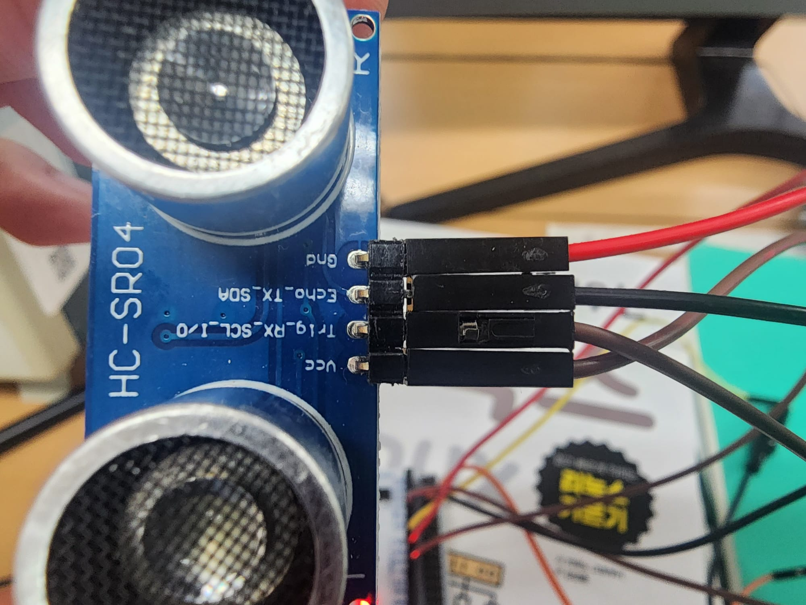
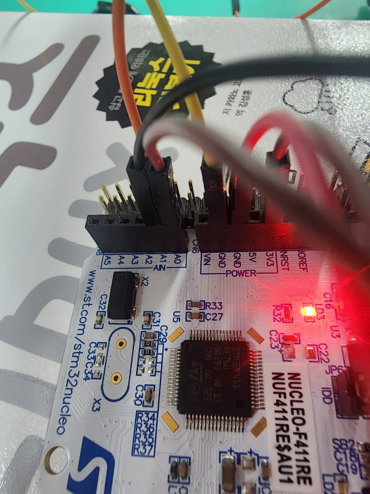
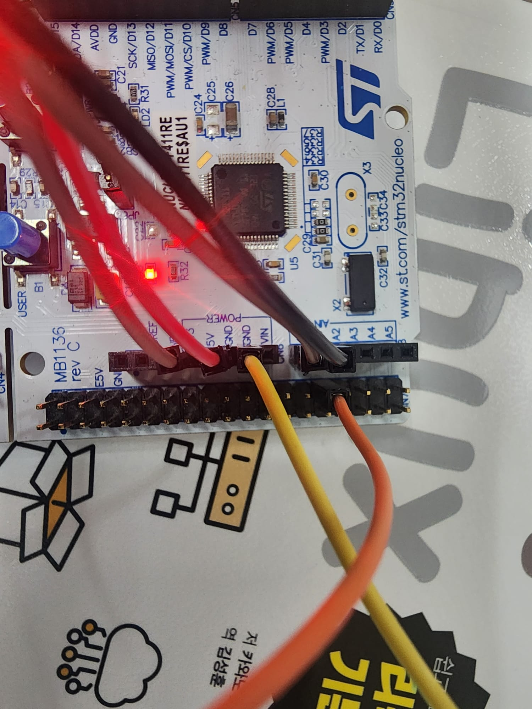
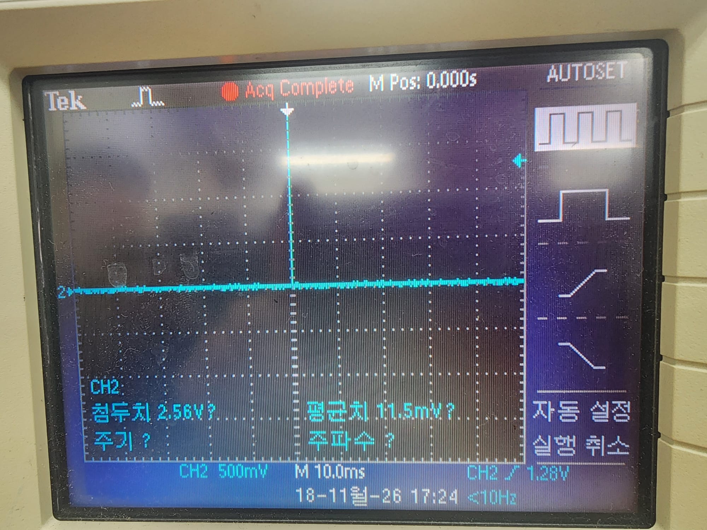
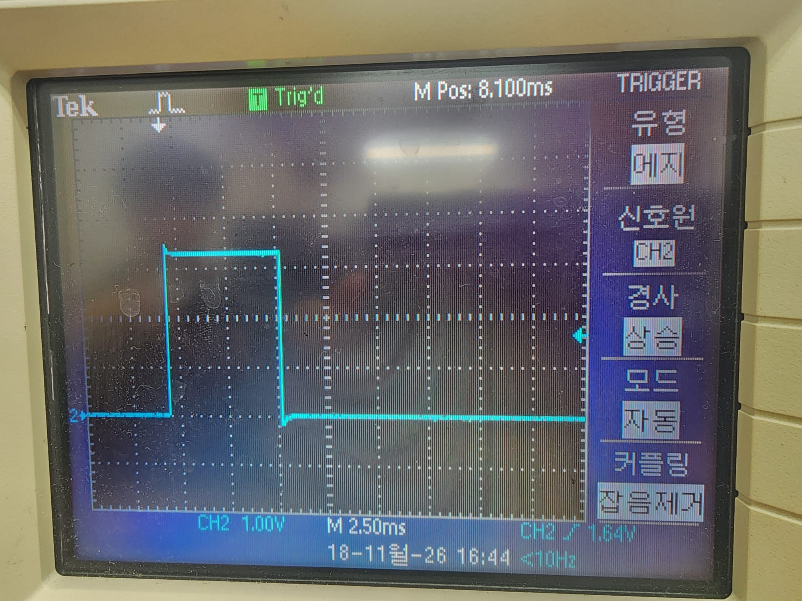
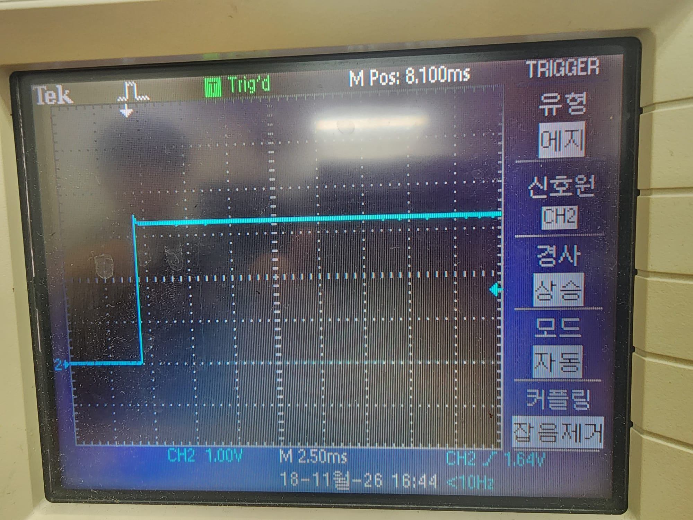

# F411_TASK_LAB 학습 정리 (STEP01 ~ STEP03)

NUCLEO-F411RE에서 LED 점멸, HC-SR04 거리 측정, DHT 온습도 기반 음속 보정까지 단계별로 구현한 내용 정리.

## 전체 구조

```text
STEP01  LED 점멸 (비차단 주기 작업)
STEP02  HC-SR04 거리 측정 (TIM2 1MHz + EXTI + 상태 머신 + 중앙값)
STEP03  DHT11/22 온습도 + 음속 보정 (보정 전/후 거리 비교)
STEP04  (예정) FreeRTOS 태스크 분리
```

## STEP01 - 비차단 LED 점멸

- `HAL_Delay(500)` 대신 "마지막 실행 시각 + 주기" 패턴을 쓴다.

```c
if ((now - last) >= period) { last = now; /* 주기 작업 */ }
```

- `uint32_t` 뺄셈이라 `HAL_GetTick()`이 wrap해도 올바르게 동작한다.
- 이 패턴은 FreeRTOS `vTaskDelayUntil()`과 같은 개념이라, `LED_Task()`가 나중에 그대로 RTOS 태스크가 된다.
- `500U`의 `U`는 단위가 아니라 unsigned 접미사다. 값의 단위는 `HAL_GetTick()` 기준 ms다.
- 슈퍼루프 주기 조건
  - 한 바퀴 시간 `P = C_LED + C_SENSOR + C_UART + ...` (C는 평균이 아니라 최악 실행시간 WCET)
  - 실제 LED 주기는 `500 ms + 루프 1바퀴 시간`까지 늘어날 수 있다.
  - 확인할 것: 태스크별 마감시간, blocking 호출, ISR 시간, jitter, CPU 사용률(보통 50~70% 이하)
  - 정확한 주기가 필요하면 타이머 인터럽트나 `vTaskDelayUntil()`을 쓴다.

## STEP02 - HC-SR04 거리 측정

### 설정값
| 항목 | 값 |
|---|---|
| TRIG / ECHO | PA1 출력 / PA0 (EXTI 양쪽 에지) |
| 샘플 / 출력 | 200 ms (5 Hz) / 1000 ms (1 Hz 중앙값) |
| 타임아웃 | 35 ms |
| 유효 펄스 / 거리 | 100~30000 us / 20~4000 mm |

### 핵심 개념
- **ECHO 분압**: ECHO는 5 V 출력이라 1 kΩ + 2 kΩ 분압(약 3.3 V)으로 PA0에 연결한다. GND는 공통.
- **TIM2를 1 MHz로**: 84 MHz / (83+1) = 1 MHz라서 1 tick = 1 us. 32비트 카운터라 `끝 - 시작`을 `uint32_t`로 계산하면 wrap도 자동 처리된다. (`HAL_GetTick()`은 1 ms 해상도라 부족)
- **EXTI는 시각 기록만**: ISR에서는 상승/하강 에지 시각만 저장하고, 거리 계산, 필터, 출력은 메인 루프에서 한다.
- **비차단 상태 머신**: `IDLE`(주기 대기) -> TRIG 10 us -> `WAIT_ECHO`(펄스 완료 또는 35 ms 타임아웃).
- **중앙값 필터**: 최근 5개 중앙값. 단발 튐에 강하고, 평균보다 이상값에 덜 끌린다.
- **정수 거리 공식**: `distance_mm = pulse_us * 343 / 2000` (왕복이라 2로 나눔). `30000 * 343`이 `uint32_t` 범위 안이라 안전하다.
- **`.ioc` 미수정**: Advanced Folder Structure 프로젝트라, 재생성 시 USER CODE와 충돌하지 않도록 `ultrasonic.c`에서 직접 초기화했다. 재생성 후에는 `HAL_TIM_MODULE_ENABLED`가 주석 처리되지 않았는지 확인해야 한다.

### 출력 (UART CSV)
`D,t_ms,distance_mm,valid,errors` (STEP03에서 확장됨)

## STEP03 - 온습도 + 음속 보정

### DHT 프로토콜
- MCU가 LOW 20 ms -> 센서 응답 -> 40 bit (bit 0은 HIGH 약 27 us, bit 1은 약 70 us, 기준 50 us) -> checksum.
- checksum: `(b0+b1+b2+b3) & 0xFF == b4`
- **DHT11/22 자동 판별**: DHT22 형식(16 bit)으로 먼저 해석해 보고, 유효 범위를 벗어나면 DHT11 형식으로 해석한다.
- 읽기 주기는 2초(DHT22 최소 2초 간격 권장). 전원/풀업은 3.3 V 기준으로 통일한다.

### 음속 보정
```text
v(m/s) = 331.3 + 0.606 * T(C)
v_x10  = 3313 + (606 * temp_x10) / 1000      (정수 연산)
distance_mm = pulse_us * v_x10 / 20000
```
- 예: 23.2 C -> 345.3 m/s. 20 C 고정값(343.0)보다 약 0.7% 멀게 계산되고, 1.685 m에서 약 12 mm 차이가 난다.
- `distance_ref_mm`(20 C 고정)과 `distance_mm`(보정)을 **같은 펄스 폭**에서 계산해서, 보정 효과만 직접 비교한다.
- 실제 보드 로그: `D,3000,1687,1699,12,1,0` / `E,4014,232,340,1,0,3453` (23.2 C, 34.0 %RH, delta 약 +12 mm)

### 설계 포인트
- **정수 10배 값 사용**: nano.specs 빌드에서 `snprintf`의 `%f`가 기본 지원되지 않아 `235 = 23.5 C`처럼 정수로 출력한다.
- **블로킹 충돌 회피**: DHT 읽기는 약 25 ms 블로킹이라, `Ultrasonic_IsIdle()`일 때만 읽어 ECHO를 놓치지 않게 한다.
- **초기화 순서**: DHT가 TIM2 카운터를 마이크로초 기준으로 재사용하므로 `Ultrasonic_Init()` 다음에 `Dht_Init()`을 호출해야 한다. (반대면 HardFault)
- **실패 처리**: DHT 읽기 실패 시 `E`의 `valid=0`을 출력하고, 마지막 성공 음속을 유지한다.

### 디버깅 경험
- 초기에 `valid=0`이 반복된 원인은 DHT DATA/GND/VCC 배선이었고, 재연결 후 정상 동작했다. 소프트웨어를 의심하기 전에 배선, 풀업, 공통 GND를 먼저 본다.

## 다음 단계: STEP04 (FreeRTOS)
- LED(500 ms), 초음파(200 ms + 1초 중앙값), DHT(2초, 블로킹), 로그(큐/스트림 버퍼) 태스크로 분리한다.
- HAL timebase를 TIM6 등으로 옮겨 SysTick과 충돌하지 않게 한다.
- DHT의 25 ms 블로킹 읽기를 별도 태스크로 빼서 LED/초음파 지터를 줄인다.

## 코드 리뷰 메모
1. STEP02 문서의 상태 머신에는 `TRIG_HIGH` 상태가 있지만, 실제 코드는 `IDLE`/`WAIT_ECHO` 두 상태이고 TRIG 10 us는 TIM2 카운터로 busy-wait한다. 10 us라 허용 가능하지만 문서와 코드를 맞추는 편이 좋다.
2. 위 busy-wait와 DHT 25 ms 블로킹은 RTOS 전환 시 태스크 분리 또는 입력 캡처(TIM CCR)로 바꾸면 지터를 더 줄일 수 있다.
3. 유효 범위 판정은 보정 후 `distance_mm` 기준이고, 보정 전 값은 비교용이다. 같은 샘플이 두 필터에 들어가므로 두 중앙값이 항상 짝을 이룬다.
4. `D`의 `valid=0` 구간에는 거리와 delta가 모두 0으로 출력된다. 분석할 때는 `valid`로 먼저 걸러야 한다.
5. 정확도를 높이려면 DHT22를 쓰고, 센서 근처 온도를 측정해야 한다. (DHT11은 +-2 C라 보정 효과가 오차에 묻힐 수 있다)

## 하드웨어 확인 (배선 사진 + 오실로스코프, 2026-11-18)

### 배선 사진
| 사진 | 내용 |
|---|---|
|  | HC-SR04 핀 순서: Gnd / Echo(TX,SDA) / Trig(RX,SCL,I/O) / Vcc. 4핀 듀폰 커넥터가 연결되어 있다. |
|  | 아날로그 헤더 A0, A1 위치에 선이 꽂혀 있다. A0 = PA0(ECHO), A1 = PA1(TRIG)과 일치한다. |
|  | 전원 헤더에 5V(빨간 선)와 GND 연결이 보인다. |

배선 체크 포인트
- 사진 속 듀폰 선 색이 관례(빨강=VCC, 검정=GND)와 다르다. 센서의 Gnd 핀에 빨간 선이 연결된 것처럼 보이므로, 전원을 넣기 전에 멀티미터로 센서 Vcc-Gnd 극성과 보드 5V/GND와의 대응을 한 번 확인하는 것이 안전하다. (사진만으로는 선이 어디로 이어지는지 단정할 수 없다.)
- 사진에서는 ECHO 분압 저항(1 kΩ + 2 kΩ)이 보이지 않는다. 브레드보드 쪽에 있는지 확인한다. ECHO는 5 V 출력이라 직접 PA0에 연결하면 안 된다.

### 오실로스코프 측정 (CH2, Tektronix)
| 사진 | 설정 | 관찰 | 해석 |
|---|---|---|---|
|  | 500 mV/div, 10 ms/div | 얇은 스파이크 1개, 나머지는 0 V | TRIG의 10 us 펄스로 보인다. 10 ms/div에서는 펄스가 너무 얇아 샘플링되며, 화면의 첨두치 2.56 V는 물음표(?)가 붙은 신뢰할 수 없는 값이다. |
|  | 1 V/div, 2.5 ms/div, 상승 에지 트리거 | 진폭 약 3.3 V, HIGH 폭 약 2.2 div = 약 5.5 ms | 정상 ECHO 펄스. 거리 = 5500 us x 343 / 2000 = 약 940 mm (0.94 m). 진폭이 3.3 V라서 PA0에 3.3 V 로직으로 들어오고 있다. |
|  | 1 V/div, 2.5 ms/div | 상승 후 화면 끝(약 20 ms 이상)까지 계속 HIGH | 반사체가 없거나 범위 밖일 때 나오는 긴 ECHO(HC-SR04는 약 38 ms)와 같은 모양이다. |

학습 포인트
- **측정값 검증**: 오실로스코프 폭으로 거리를 계산해 시리얼의 `distance_mm`과 직접 대조할 수 있다. (5.5 ms -> 약 940 mm)
- **긴 ECHO와 코드의 관계**: 38 ms급 ECHO는 `US_ECHO_TIMEOUT_MS`(35 ms)에 먼저 걸리고, 펄스 폭도 `US_MAX_PULSE_US`(30000 us)를 넘는다. 그래서 `valid=0`, `errors` 증가로 나타나는 것이 정상 동작이다.
- **시간축 선택**: 10 us 펄스(TRIG)는 10 us/div ~ 5 us/div로 놓고 확인해야 폭과 진폭이 제대로 보인다. ECHO는 2.5 ms/div처럼 ms 단위가 맞다.
- **트리거**: ECHO는 상승 에지 트리거(CH2)로 잡았고, 커플링은 노이즈 제거 모드를 썼다. 측정 전에 AUTOSET 결과를 그대로 믿지 말고 시간축, 전압축을 목적에 맞게 조정한다.
