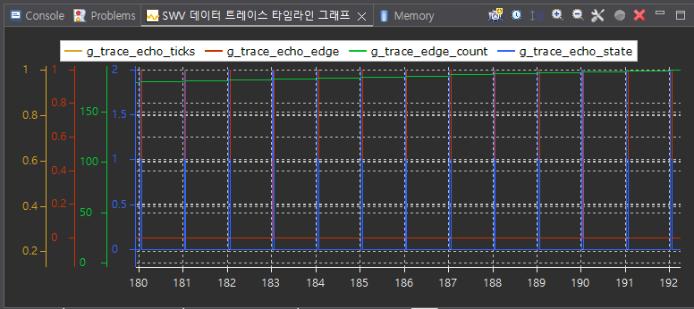
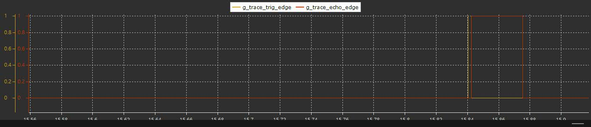
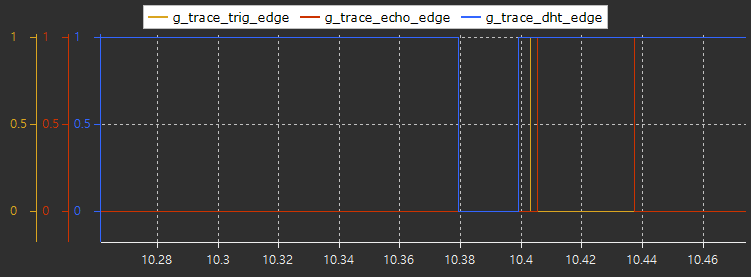

# STEP02 ~ STEP03 학습 정리 - 초음파 거리 측정 + 온습도 음속 보정

> NUCLEO-F411RE / HC-SR04 / DHT11·22 / SWV(Serial Wire Viewer) 트레이스

---

## 0. 한 줄 요약

- 초음파 거리는 **"에코 펄스 폭 x 음속 / 2"** 이고, 음속은 온도에 따라 변하므로 DHT 온습도로 **음속을 보정**하면 거리 정확도가 올라간다.
- 하나의 1 MHz 타이머(TIM1)를 **초음파와 DHT가 공용**으로 쓰고, 16비트 랩어라운드는 `uint16_t` 뺄셈으로 처리한다.
- SWV 트레이스로 **TRIG - ECHO - DHT 신호의 시간 관계**를 눈으로 확인했다.

---

## 1. STEP02 복습 - 초음파 측정의 뼈대

| 항목 | 내용 |
|---|---|
| 핀 | TRIG=PA1(출력), ECHO=PA0(EXTI 양쪽 에지, 5 V -> 1 kΩ/2 kΩ 분압) |
| 시간 기준 | TIM1: 84 MHz / 84 = **1 MHz** (1 tick = 1 us), 16비트 |
| 거리식 | `mm = width_us x 음속(x10) / 20000` (왕복이라 2로 나눔) |
| 구조 | `HAL_Delay()` 없는 **비차단 상태 머신** (IDLE / WAIT_ECHO) |
| 주기 | 200 ms 샘플, 5개 중앙값을 1 s마다 출력 |
| 유효 범위 | 펄스 100 ~ 30000 us, 거리 20 ~ 4000 mm, 타임아웃 35 ms |

배운 점
- 계산식이 맞아도 **센서 각도/반사면** 때문에 엉뚱한 거리가 나올 수 있다 (1.5 m 기대 -> 0.71 m 측정, 각도 조정 후 1681 mm).
- EXTI 콜백은 모든 GPIO가 공유하므로 `GPIO_Pin` 분기가 필수.
- 16비트 타이머 폭 계산은 `(uint16_t)(fall - rise)` 한 줄로 오버플로까지 해결된다.

---

## 2. STEP03 - DHT 온습도로 음속 보정

### 2.1 왜 보정하는가
`거리 = (에코시간 x 음속) / 2` 이므로 **음속 오차 = 거리 오차**. 기존엔 20 °C 기준 343.0 m/s 고정값을 썼다.

### 2.2 보정식 (정수 연산, 단위 0.1 m/s)

```
v = 3313 + (606 x T_x10) / 1000 + (12 x RH_x10) / 1000
```

- 온도항 0.606 m/s/°C, 습도항 약 0.0124 m/s/%RH
- `2500 ~ 4000` 범위 클램프로 비정상 값 차단
- DHT가 `valid=1`일 때만 `Ultrasonic_SetSoundSpeedX10()`으로 갱신 (오류 시 마지막 유효값 유지)

**검산 메모**: 20.5 °C, 50.3 %RH를 코드 그대로(정수 나눗셈) 계산하면
`3313 + 124 + 6 = 3443` (344.3 m/s)이다. STEP03 문서 예시의 `3441`은 약 0.2 m/s 차이가 있으니 문서 값은 "약 3441~3443" 정도로 보면 된다.

### 2.3 통합 설계 판단

| 문제 | 판단 |
|---|---|
| DHT 소스가 TIM2를 사용 | 메인에는 TIM2 초기화 없음 -> **DHT 쪽을 TIM1(1 MHz)에 맞춤** |
| DHT 데이터 핀 | 미사용 핀 **PA4** 사용 (USART/SWD/TRIG/ECHO와 충돌 없음) |
| 16비트 카운터 | 지연/타임아웃/비트 폭 모두 `DHT_ElapsedUs()`의 `(uint16_t)` 뺄셈으로 통일 |
| 초기화 순서 | `Ultrasonic_Init()`(TIM1 시작) -> `Dht_Init()` |

### 2.4 DHT 통신 요약
1. MCU가 DATA를 **20 ms LOW** -> 30 us release
2. 센서 응답(LOW/HIGH) 후 **40비트 MSB-first** 수신
3. HIGH 폭 **50 us 초과 = 1**, 이하 = 0
4. 체크섬 검증 -> DHT22(16비트) / DHT11(정수+소수) 자동 디코딩
5. 2 s 주기, 1회 읽기 약 24 ms (블로킹)

### 2.5 시리얼 출력

| 프리픽스 | 의미 |
|---|---|
| `D` | 거리(보정 음속 적용) |
| `C` | 마지막 에코 펄스 폭(us) |
| `TH` | 온도x10, 습도x10, valid, errors |
| `ENV` | 사람이 읽기 쉬운 온습도 |
| `S` | 적용된 음속(x10) |

### 2.6 배선 확인 (사진 기준)

| 신호 | MCU 핀 | NUCLEO 헤더 |
|---|---|---|
| ECHO (분압 후) | PA0 | A0 |
| TRIG | PA1 | A1 |
| DHT DATA | PA4 | **A2** |
| HC-SR04 VCC | - | 5V |
| DHT VCC | - | 3V3 (또는 모듈 사양에 맞는 전원) |
| GND | - | GND (센서와 보드 공통) |

> 주의: PA4는 아날로그 헤더 **A2** 위치다. 실크의 A4는 PC1이므로 혼동하지 말 것.

DHT 모듈 메모
- 파란 케이스, 3핀(VCC / DATA / GND) 모듈 -> DHT11로 보인다.
- 기판의 작은 저항에 `472`(4.7 kΩ)가 찍혀 있어 **풀업이 모듈에 이미 포함**되어 있다. 외부 풀업은 필수가 아니다.
- 모듈 글씨 방향 기준 `VCC DATA GND` 순서와 점퍼 순서가 맞는지 확인 (거꾸로 꽂으면 VCC/GND가 바뀐다).
- 보드의 LD3(빨간 전원 LED) 점등으로 전원 공급은 정상임을 확인했다.
- DHT11 온도 오차는 약 ±2 °C -> 음속 약 1.2 m/s(약 0.35 %) -> 1.68 m에서 약 6 mm. 보정 효과가 이 오차 범위 안이므로, 보정 전/후를 실측으로 비교해 이득을 확인한다.

---

## 3. SWV 트레이스로 본 신호 타이밍

사용한 트레이스 변수: `g_trace_echo_ticks`, `g_trace_echo_edge`, `g_trace_edge_count`, `g_trace_echo_state` (+ TRIG/DHT 확인용 `g_trace_trig_edge`, `g_trace_dht_edge`).
비교기(Comparator)는 최대 4개라서 한 번에 볼 변수를 골라야 한다.

### 3.1 에코 상태/에지 타임라인



- `echo_state`가 측정 주기마다 **2(TRIG 후 대기) -> 1(ECHO Rising) -> 0(Falling/Idle)** 으로 움직이는 패턴이 반복된다.
- `echo_edge`는 Rising에서 1, Falling/Timeout에서 0으로 내려오는 펄스로 보인다.
- `edge_count`(초록)는 에지마다 증가하므로 **계단식 상승**한다. Trace 시작 전부터 누적된 값이라 절대값보다 "증가 추세"를 본다.

### 3.2 TRIG 와 ECHO



- TRIG는 10 us 펄스라 그래프에서는 **거의 선 하나**로 보인다.
- 그 직후 `echo_edge`가 1로 올라가 한동안 유지된다.
- 이 캡처의 HIGH 구간은 눈금상 **약 32 ms**로, 유효 상한(30000 us)을 넘는다. 즉 이 구간은 **무반사/원거리/타임아웃 계열의 에러 샘플**일 가능성이 높다. (정상 1681 mm는 약 9.8 ms)

### 3.3 TRIG / ECHO / DHT 가 한 화면에



- `dht_edge`가 변하는 두 지점의 간격이 **약 20 ms**로 보이며, DHT 시작 신호(20 ms LOW)와 일치한다.
- DHT 읽기가 끝난 직후에 TRIG가 나가고 ECHO가 이어진다. 코드에서 `Dht_Task()`를 `Ultrasonic_Task()`보다 **먼저** 호출하는 구조와 맞는 모습이다.
- DHT 읽기(약 24 ms)가 메인 루프를 **블로킹**한다는 점을 눈으로 확인할 수 있다.

> 그래프 해석은 눈금에서 읽은 근사값이다. 정확한 수치는 `SWV Data Trace`의 History(DWT 사이클 카운터, 84 MHz)로 확인할 것.

---

## 4. 주의사항 / 시행착오

- **센서 면 정렬**: 수직이 조금만 어긋나도 옆/아래 물체를 측정한다.
- **ECHO 5 V 분압 필수**, GND 공통.
- **DHT는 블로킹 약 24 ms** - 초음파 타임아웃(35 ms)보다 짧아 당장은 충돌하지 않지만, 주기 작업이 늘면 비차단 구조(타이머/DMA)로 바꾸는 것이 좋다.
- DHT 전원 직후 첫 1~2회 값은 불안정할 수 있다.
- SWV: Start Trace를 먼저 누르고 Resume. Watch 4개 값은 같은 순간의 스냅샷이 아니므로 변수별 History를 따로 본다.
- UART `printf`는 ITM 콘솔에 나오지 않는다 (`ITM_SendChar()` 별도 필요).

---

## 5. 다음에 해볼 것 (TODO)

- [ ] `distance_ref_mm`(고정 음속)와 `distance_mm`(보정 음속)를 같이 출력해 **보정 전/후 차이** 비교
- [ ] 줄자 기준 0.2 / 0.5 / 1.0 / 2.0 m 정적 측정으로 오차(±1 cm 목표) 표 작성
- [ ] 32 ms급 긴 에코가 나오는 조건(무반사, 각도) 재현 후 `errors` 증가 확인
- [ ] DHT 읽기를 비차단 방식으로 개선 검토
- [ ] 온도를 바꿔(손으로 감싸기 등) `S` 값 변화와 `D` 변화 관찰
