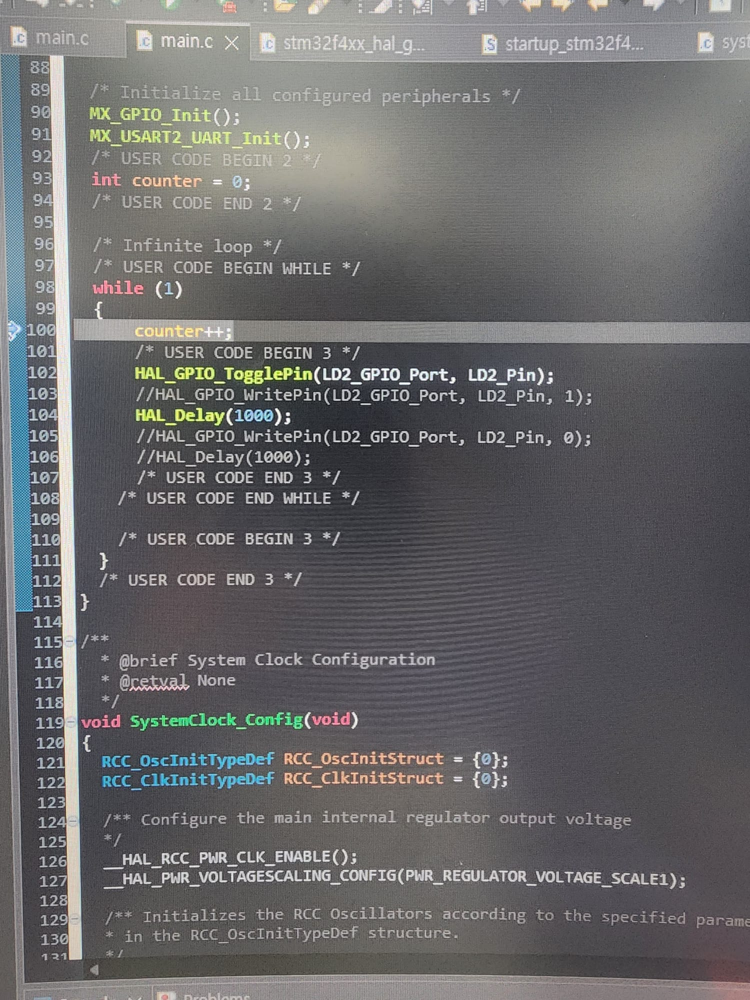
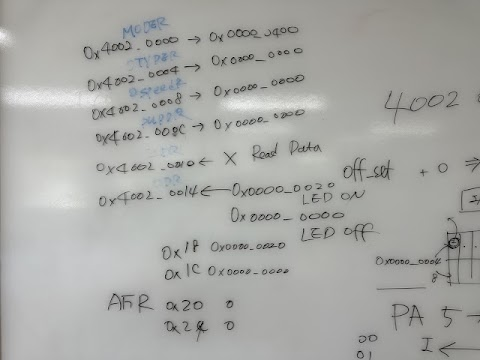
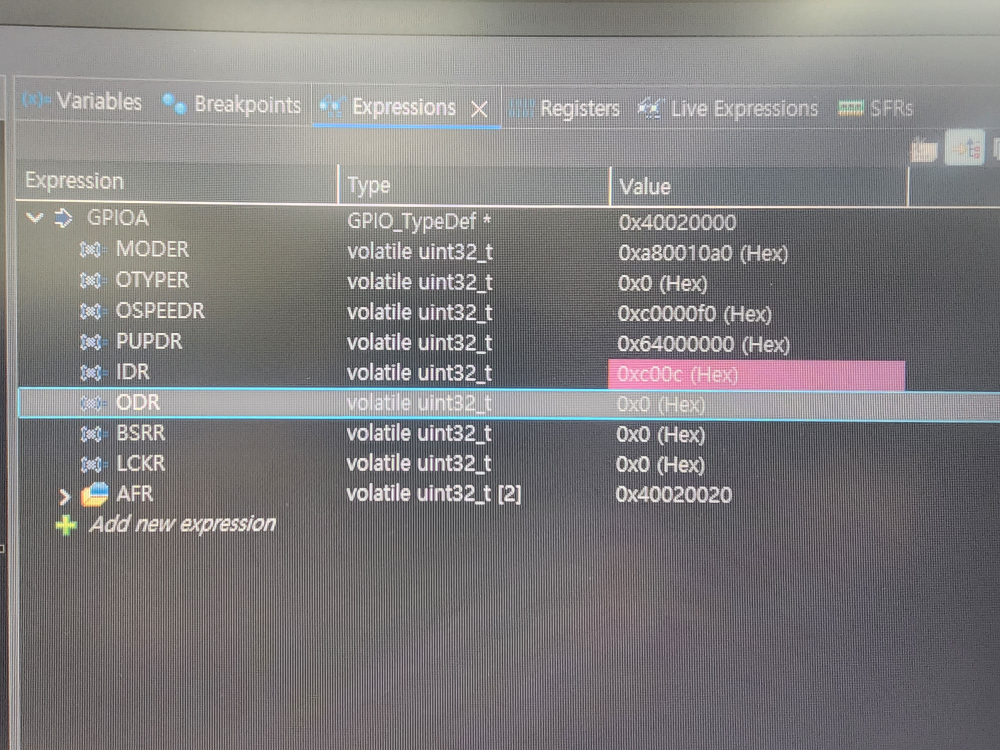
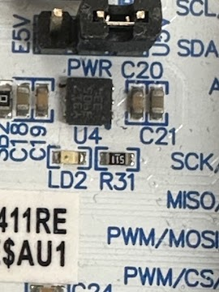
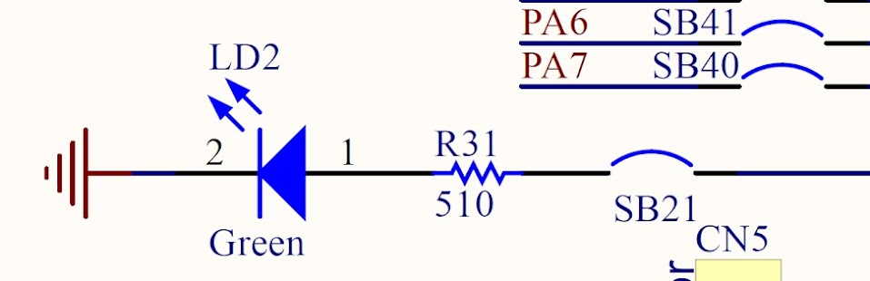
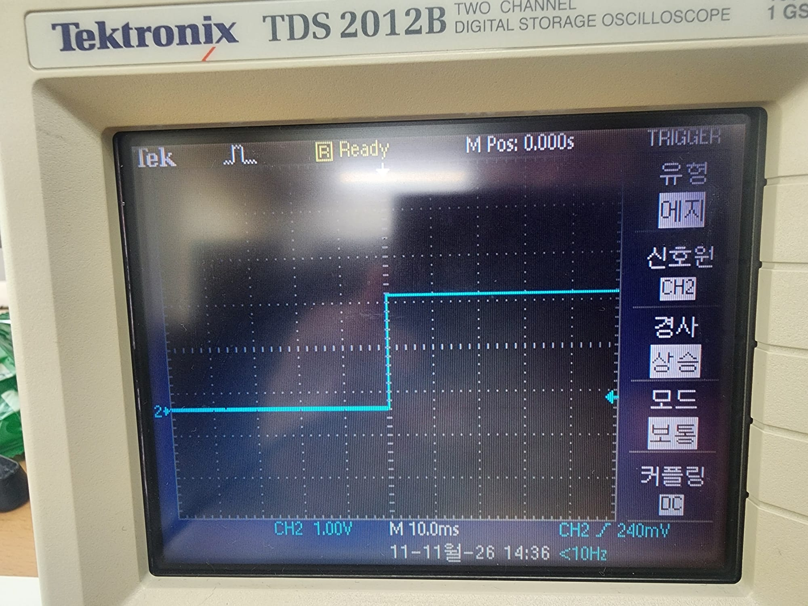
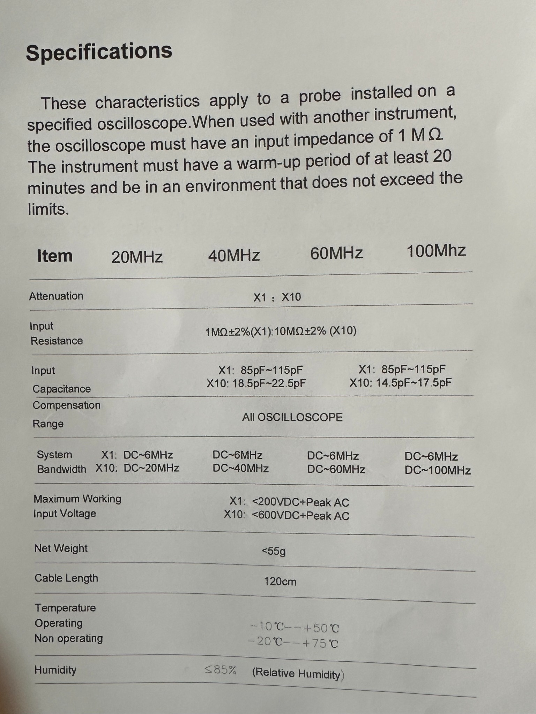

GPIO — STM32F411 실습 기록
Datasheet — STM32F411xC / STM32F411xE
RM0383 Reference Manual — STM32F411xC/E
Table of Contents
교수님 F411 자료 복습 (접기식)
1. Architecture
2. CLOCK
3. Memory Map
4. GPIO / Register
5. Test
이번 실습
LED 토글 코드
GPIO 구조와 레지스터
LD2 LED 회로 확인
오실로스코프 출력
실습 결과 및 배운 점
---
실습일: 2026-11-11  
환경: NUCLEO-F411RE 계열 보드, STM32CubeIDE, Tektronix TDS 2012B  
참고: 수업 GPIO_DOC
이번에는 STM32F411의 GPIO로 LED를 제어하고, 디버거와 오실로스코프로 출력 상태를 살펴봤다. 코드는 `TogglePin()`을 사용했고, 레지스터 주소와 LD2 회로도도 함께 확인했다.
1. LED 토글 코드
STM32CubeIDE에서 작성한 반복문 중 LED 제어 부분이다.
```c
while (1)
{
    HAL_GPIO_TogglePin(LD2_GPIO_Port, LD2_Pin);
    HAL_Delay(1000);
}
```
`TogglePin()`은 LED에 연결된 GPIO의 출력 상태를 반대로 바꾼다. `HAL_Delay(1000)`은 다음 반전까지 약 1초 대기한다. 코드대로 동작한다면 출력 상태는 약 1초마다 바뀌고, 전체 점멸 주기는 약 2초가 된다. 이 코드는 전체 `main.c`가 아니라 동작을 설명하기 위해 발췌한 부분이다.

2. GPIO 구조와 레지스터
GPIO는 MCU가 외부 회로와 신호를 주고받는 핀이다. 핀의 모드를 설정하고 출력값을 바꾸는 작업은 GPIO 레지스터를 통해 이루어진다. STM32F411의 GPIO는 AHB1 버스에 연결된다.
GPIOA 레지스터	주소	역할
`MODER`	`0x40020000`	각 핀의 모드 설정
`OTYPER`	`0x40020004`	푸시풀·오픈드레인 선택
`OSPEEDR`	`0x40020008`	출력 속도 설정
`PUPDR`	`0x4002000C`	풀업·풀다운 설정
`IDR`	`0x40020010`	입력 상태 읽기
`ODR`	`0x40020014`	출력 데이터 상태
`BSRR`	`0x40020018`	특정 비트 설정·초기화
`AFRL` / `AFRH`	`0x40020020` / `0x40020024`	대체 기능 선택
`MODER`는 핀 하나당 2비트를 사용한다. `00`은 입력, `01`은 출력, `10`은 대체 기능, `11`은 아날로그 모드이다.

디버거의 Expressions 창에서 GPIOA 레지스터를 확인했다.

촬영한 화면의 `MODER` 값은 `0xA80010A0`이다. 이를 비트로 나누어 보면 **PA5는 `00`(입력), PA6은 `01`(출력)**로 읽힌다. 참고한 NUCLEO-F411RE 회로도에서는 LD2가 PA5 쪽에 연결되어 있으므로, 이 캡처가 어느 초기화 단계의 화면인지 살펴볼 필요가 있다. `MX_GPIO_Init()`과 `main.h`의 `LD2_Pin` 정의를 함께 비교해 보면 정확히 알 수 있다.
3. LD2 LED 회로 확인
보드에서 LED 위치를 찾은 뒤 ST의 **MB1136 참고 회로도(Revision C-04)**와 비교했다. 이 회로도에서 사용자 LED인 LD2는 PA5 / Arduino D13 신호와 연결되어 있다.
참고 회로도의 신호 경로
```text
PA5 ─ SB42 ─ D13 ─ SB21 ─ R31 (510 Ω) ─ LD2 ─ GND
```
PA5: LED 제어에 사용하는 MCU의 GPIO 핀
SB42·SB21: 회로의 연결 상태를 정하는 솔더 브리지
R31: LED 전류를 제한하는 직렬 저항. 참고 회로도에는 `510 Ω`으로 표시됨
LD2: 보드에 달린 사용자 LED
출력이 High일 때 전류가 흐를 수 있는 경로이며, 해당 브리지가 연결된 보드 구성이라는 전제가 있다. 참고 회로도의 값과 실제 사용한 보드의 실장값이 항상 같다고 볼 수는 없다. 정확한 연결 및 저항값은 보드 리비전이나 BOM을 대조해야 한다.



PCB 이미지에 함께 보이는 U4나 C21은 주변 부품의 위치를 보여 주는 것이지, LD2 직렬 경로의 일부라고 볼 수는 없다.
ST MB1136 회로도 원본 (5쪽 Extension connectors)
<details>
<summary>참고 — 수업에서 제공된 LED 데이터시트</summary>
Everlight `19-213SYGC/S530-XX/TR8` 자료에는 순방향 전압 대표값 2.0V와 최대 순방향 전류 25mA 등이 정리되어 있다. 다만 이 모델이 실제 LD2에 사용된 부품인지 확인한 자료는 없다. 그래서 이 사양을 오늘 보드의 측정값이나 실제 장착 부품의 사양으로 사용하지 않았다.
</details>
4. 오실로스코프에서 확인한 출력
Tektronix TDS 2012B의 CH2에서 신호가 올라가는 상승 에지와 내려가는 하강 에지를 촬영했다.


화면에는 CH2 `1.00V/div`, 시간축 `10.0ms/div`이 표시되어 있었다. 이 사진으로는 신호가 바뀌는 모습을 볼 수 있지만, 약 2초인 전체 주기가 직접 측정된 것은 아니다. 주기를 측정하려면 시간축을 더 길게 잡아 여러 에지가 한 화면에 나오게 하면 된다.
프로브 설정
수업에서 받은 프로브 사양표를 보면서 X1과 X10의 차이도 확인했다. X1은 1배, X10은 10배 감쇠 설정이다. 실제 프로브 스위치와 오실로스코프의 채널 설정이 서로 같아야 전압을 올바르게 읽을 수 있다.

5. 실습 결과 및 배운 점
GPIO 레지스터로 핀의 동작 방식을 정하고, C 코드에서 출력값을 바꾸면 실제 핀의 신호가 변한다는 흐름을 배웠다. 디버거에서는 레지스터 값을 확인했고, 오실로스코프에서는 상승·하강 에지를 관찰했다.
또 회로도를 볼 때는 실제 핀과 LED 사이의 연결 경로를 먼저 확인해야 한다는 점을 알게 됐다. 부품 사진만 보고 저항값이나 핀 연결을 단정할 수는 없었다.
다음에 확인할 것
[ ] `main.h`의 `LD2_Pin`과 `MX_GPIO_Init()`의 출력 핀 설정 비교
[ ] 레지스터 캡처 시점이 GPIO 초기화 전인지 후인지 확인
[ ] 오실로스코프의 실제 주기·전압 측정값 기록
[ ] 사용 보드 리비전과 R31의 실장값 확인
---
6. 교수님 STM32F411 자료 복습
아래는 교수님 GPIO_DOC에서 F411에 해당하는 설명과 그림을 항목별로 다시 정리한 것이다. 그림은 수업 자료의 원본 링크로 표시하고, 위 1~5절의 실습 사진과 구분했다. 제목을 눌러 펼칠 수 있다.
6.1 Architecture
<details>
<summary><strong>Architecture — STM32F411 (그림 2장)</strong></summary>
Cortex-M4는 코드를 실행하고, AHB 버스를 통해 GPIO와 같은 주변장치 레지스터에 접근한다. STM32F411에서 GPIO는 AHB1 쪽에 연결된다.
시스템 버스 구조

Cortex-M4와 버스 연결

</details>
6.2 CLOCK
<details>
<summary><strong>CLOCK — STM32F411 (그림 2장)</strong></summary>
GPIO를 사용하려면 먼저 RCC에서 해당 포트의 클록을 켜야 한다. `MX_GPIO_Init()` 코드에서 GPIOA 클록 활성화 부분을 확인할 수 있다.
STM32F411 클록 구조 (1)

STM32F411 클록 구조 (2)

</details>
6.3 Memory Map
<details>
<summary><strong>Memory Map — STM32F411 (그림 4장)</strong></summary>
GPIOA 레지스터는 `0x40020000`부터 시작한다. 예를 들어 `MODER`는 `+0x00`, `ODR`은 `+0x14`, `BSRR`은 `+0x18`에 있다.
메모리 구조

주변장치 주소

AHB 주소 영역

GPIO 주소 확인

</details>
6.4 GPIO Register
<details>
<summary><strong>GPIO — STM32F411 (그림 15장)</strong></summary>
GPIO 핀은 입력, 출력, 대체 기능, 아날로그 모드 중 하나로 설정한다. LED를 제어할 때는 출력 모드와 ODR·BSRR의 역할이 중요하다.
GPIO 기본 구성

입력 모드

출력 모드

대체 기능

아날로그 모드

MODER 비트

레지스터 842

레지스터 843

레지스터 844

레지스터 845

레지스터 846

레지스터 847

레지스터 848

레지스터 849

AFR 비트

</details>
6.5 Test
<details>
<summary><strong>Test — STM32F411 (그림 15장)</strong></summary>
교수님 예제는 `WritePin()`을 사용하는 디버깅 순서이다. 오늘 기록한 내 코드는 `TogglePin()`을 사용했으므로 두 코드를 동일하게 취급하지 않는다.
Expressions에서 포트 확인

SFR 창

CPU 코어 레지스터

Disassembly 메뉴

Disassembly 화면

코어 구성

Memory 창

HAL_Init

SystemClock_Config

MX_GPIO_Init

USART2 초기화 예시

WritePin High

HAL_Delay

WritePin Low

다음 HAL_Delay

내 실습과의 차이: 수업 자료는 `HAL_GPIO_WritePin()`으로 High/Low를 지정해서 확인하고, 내 코드에서는 `HAL_GPIO_TogglePin()`을 사용해 현재 상태를 반전했다.
</details>
참고 문서
교수님 STM32 GPIO_DOC — F411 내용
ST NUCLEO-64 보드 회로도 MB1136 Rev C-04
STM32F411 데이터시트
STM32F411 RM0383 레퍼런스 매뉴얼
