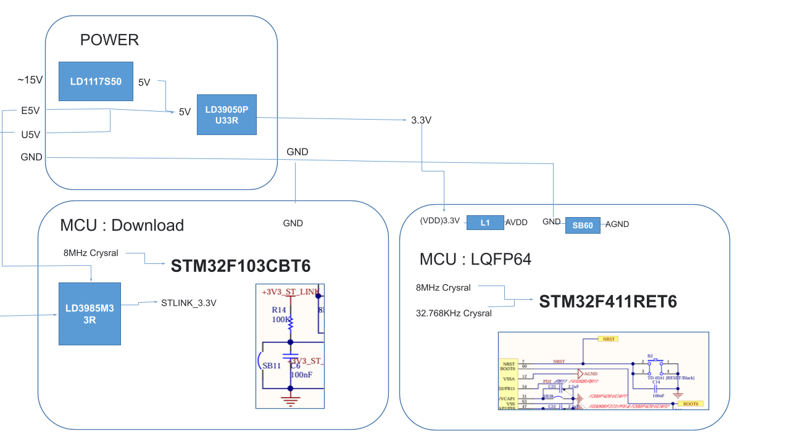
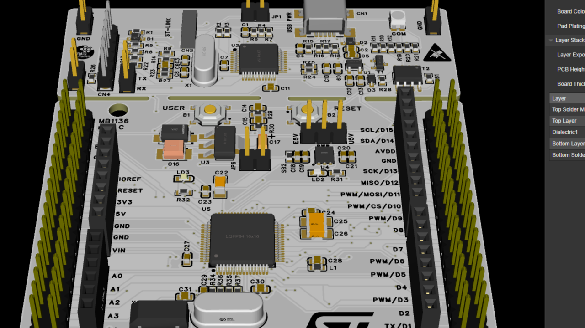
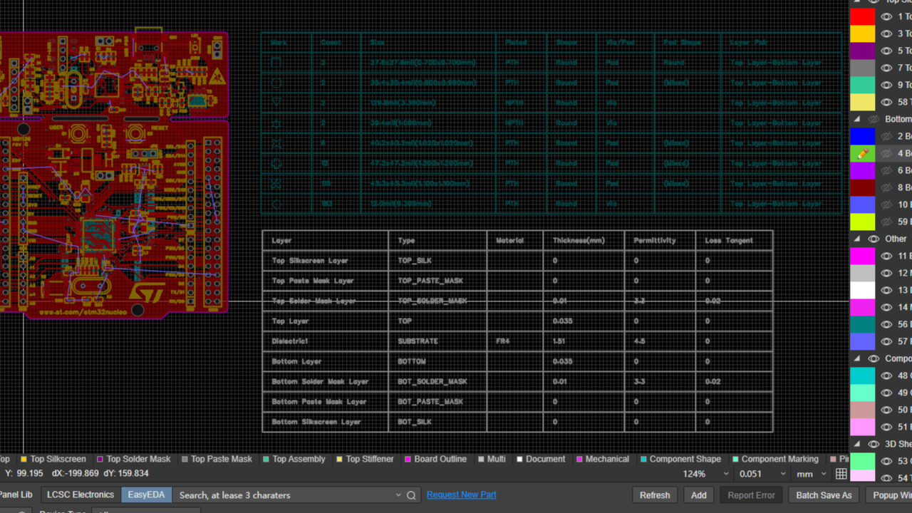
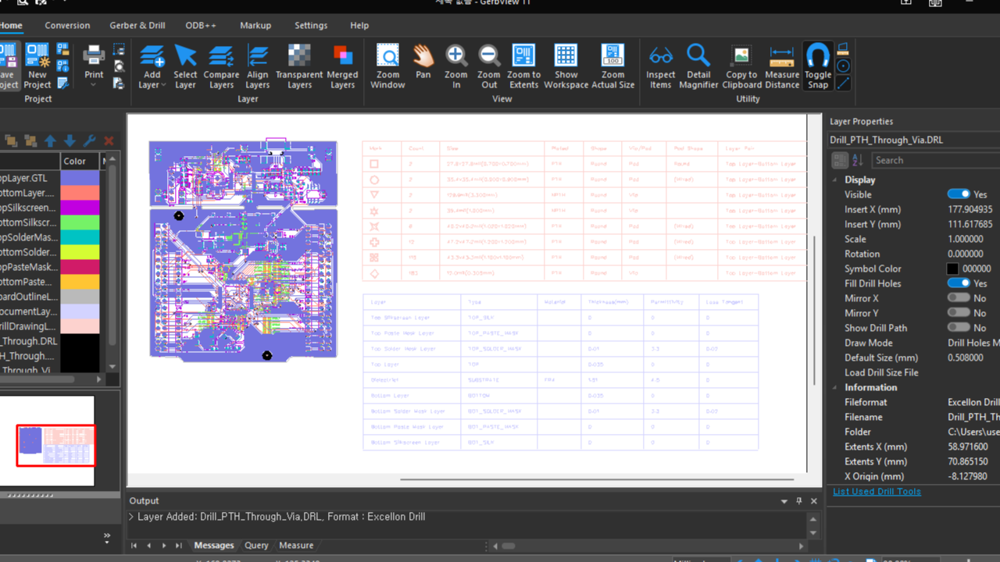
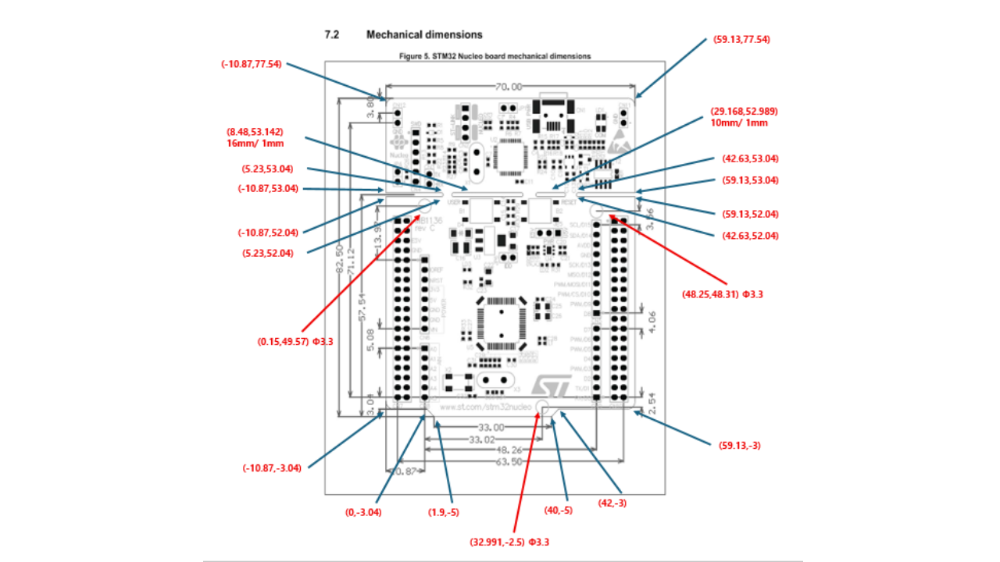

# STM32F411_Project
STM32F411_Project TEST

# H1 제목
## H2 제목
### H3 제목
#### H4 제목
##### H5 제목
###### H6 제목

---

## 텍스트 스타일링

*이탤릭체* 또는 _이탤릭체_

**볼드체** 또는 __볼드체__

***볼드 이탤릭*** 또는 ___볼드 이탤릭___

~~취소선~~

`인라인 코드`

---

## 목록 (Lists)

### 순서 없는 목록

- 항목 1
- 항목 2
  - 하위 항목 1
  - 하위 항목 2
    - 더 깊은 하위 항목

* 별표로도 가능
+ 플러스로도 가능

### 순서 있는 목록

1. 첫 번째 항목
2. 두 번째 항목
   1. 하위 항목 1
   2. 하위 항목 2
3. 세 번째 항목

### 체크리스트

- [x] 완료된 작업
- [ ] 미완료 작업
- [x] 또 다른 완료 작업

---

## 링크 (Links)

[네이버](https://naver.com)

[GitHub](https://github.com)

[링크 텍스트](https://example.com "툴팁 텍스트")

<https://example.com>

[참조 링크][1]

[1]: https://example.com "참조 링크"

### 내부 링크

[목차로 이동](#stm32f411_project)

---

## 코드 (Code)

### 인라인 코드

`console.log('Hello World')`

### JavaScript

```javascript id="k3nu7p"
function hello() {
    console.log('Hello World');
}
```

### Python

```python id="f4r9va"
def hello():
    print("Hello World")
```

### Bash

```bash id="np0m6a"
npm install package-name
```

### 들여쓰기 코드 블록

    // 4개의 공백으로 들여쓰기
    console.log('Hello');

---

## 표 (Tables)

| 열1 | 열2 | 열3 |
|-----|-----|-----|
| 데이터1 | 데이터2 | 데이터3 |
| 데이터4 | 데이터5 | 데이터6 |

### 표 정렬

| 왼쪽 정렬 | 중앙 정렬 | 오른쪽 정렬 |
|:----------|:---------:|-----------:|
| 데이터1 | 데이터2 | 데이터3 |
| 데이터4 | 데이터5 | 데이터6 |

---

## 인용문 (Blockquotes)

> 이것은 인용문입니다.

> 여러 줄의 인용문도 가능합니다.
>
> 두 번째 줄입니다.
>
> > 중첩된 인용문

---

## 구분선 (Horizontal Rules)

---

***

___

---

## HTML 태그

<details>
<summary>클릭하면 펼쳐집니다</summary>

숨겨진 내용입니다.

</details>

### 키보드 표시

<kbd>Ctrl</kbd> + <kbd>C</kbd>

### 하이라이트 태그

<mark>하이라이트된 텍스트</mark>

### 아래첨자와 위첨자

H<sub>2</sub>O

X<sup>2</sup>

---

## 이스케이프 문자

특수 문자를 그대로 표시하려면
백슬래시를 사용합니다.

\*별표\*

\#해시태그

\`백틱\`

---

## GitHub 확장 문법

### 멘션과 이슈 참조

`@username`

`#123`

커밋 해시 예제: `a1b2c3d`

### 각주 (Footnotes)

여기에 각주가 있습니다.[^1]

[^1]: 이것은 각주입니다.

### 수학 수식 (LaTeX)

인라인 수식:

$E = mc^2$

블록 수식:

$$
\sum_{i=1}^{n} x_i = x_1 + x_2 + \cdots + x_n
$$

---

## 배지 (Badges)

### 배지 사용 예제


---

# STM32F411 프로젝트 이미지

## 1. STM32F411 Block Diagram

STM32F411 보드의 전원부,
ST-LINK 다운로드 회로 및
메인 MCU의 전체 구성 블록도입니다.

<p align="center">
  
</p>

## 2. STM32F411 PCB 3D Model

PCB의 부품 배치 및 3D 모델입니다.

<p align="center">
  
</p>

## 3. STM32F411 PCB Layout

PCB 레이아웃 및 배선 구조입니다.

<p align="center">
  
</p>

## 4. STM32F411 Gerber Viewer

PCB 제작용 Gerber 데이터 및
레이어 검토 화면입니다.

<p align="center">
  
</p>

## 5. STM32F411 Mechanical Dimensions

STM32 Nucleo 보드의 기구 치수
및 주요 부품 위치 참고자료입니다.

<p align="center">
  
</p>

---

# 이미지 삽입 및 크기 조절 실습

## 1. 기본 이미지 삽입


## 2. 이미지 제목 추가


## 3. 이미지에 링크 추가

[](https://www.st.com/)

## 4. 이미지 참조 방식

![PCB Layout][image1]

[image1]: img/pcb-layout.png "PCB Layout"

---

# HTML 이미지 크기 조절

## 1. 원본 이미지 크기

<p align="center">
  
</p>

## 2. 너비 80%

<p align="center">
  
</p>

## 3. 너비 200px

<p align="center">
  
</p>

## 4. 높이 200px

<p align="center">
  
</p>

## 5. 너비 500px

<p align="center">
  
</p>

## 6. 너비와 높이 지정

<p align="center">
  
</p>

참고: width와 height를 모두 지정하면
원본 이미지의 가로세로 비율이 달라질 수 있습니다.

height="20%" 형태는 HTML 이미지 속성에서
유효한 높이 지정 방식이 아닙니다.
GitHub에서는 height="200"처럼
픽셀 단위로 지정하는 것을 권장합니다.

---

# 이미지 파일 경로

## 1. 일반적인 이미지 경로

```markdown id="8zpt6q"

```

## 2. 폴더명에 공백이 있는 경우

공백 문자는 URL에서 %20으로 표현할 수 있습니다.

원래 경로:

`my folder/image.png`

마크다운 적용:

```markdown id="n40lo3"

```

## 3. 이미지 파일명에 공백이 있는 경우

원래 파일명:

`PCB 3D Model.png`

마크다운 적용:

```markdown id="xx2pyi"

```

## 4. 이미지 파일명 주의사항

- 파일명에서 대문자와 소문자를 구분합니다.
- PNG와 png도 서로 다르게 취급될 수 있습니다.
- 폴더 경로를 정확히 입력해야 합니다.
- 파일명에는 공백 대신 하이픈(-) 사용을 권장합니다.
- 경로에 공백이 있다면 %20으로 표현할 수 있습니다.

---

# STM32F411 프로젝트 정보

| 항목 | 내용 |
|------|------|
| Project | STM32F411_Project |
| Main MCU | STM32F411RET6 |
| Debug MCU | STM32F103CBT6 |
| Architecture | ARM Cortex-M4 |
| PCB Design | EasyEDA |
| Gerber Viewer | GerbView |
| Version Control | GitHub |
| Documentation | Markdown |

---

# 프로젝트 파일 구조

    STM32F411_Project/
    |
    |-- README.md
    |
    |-- img/
        |-- block-diagram.png
        |-- pcb-3d.png
        |-- pcb-layout.png
        |-- gerber.png
        |-- mechanical.png

---

# 프로젝트 진행 상황

- [x] GitHub 저장소 생성
- [x] Markdown 문법 작성
- [x] 제목 및 텍스트 스타일 작성
- [x] 목록 및 체크리스트 작성
- [x] 링크 작성
- [x] 코드 블록 작성
- [x] 표 작성
- [x] 이미지 파일 업로드
- [x] 블록도 이미지 추가
- [x] 이미지 크기 조절 예제 작성
- [ ] README 이미지 표시 확인
- [ ] 회로도 파일 추가
- [ ] 하드웨어 테스트 결과 추가

---

# 참고 링크

[GitHub Markdown Guide](https://docs.github.com/en/get-started/writing-on-github)

[STMicroelectronics](https://www.st.com/)

[EasyEDA](https://easyeda.com/)

---

# STM32F411_Project

STM32F411 PCB 설계 자료 및
GitHub Markdown 문법 실습 프로젝트입니다.
